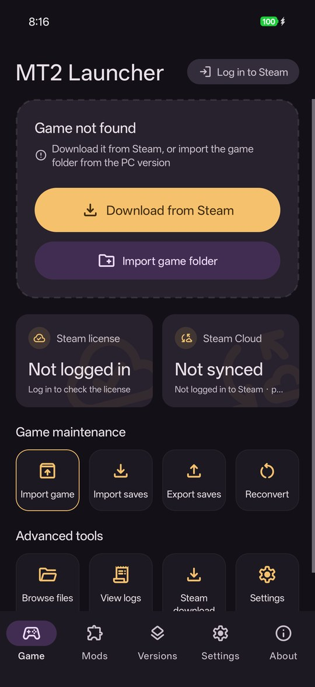
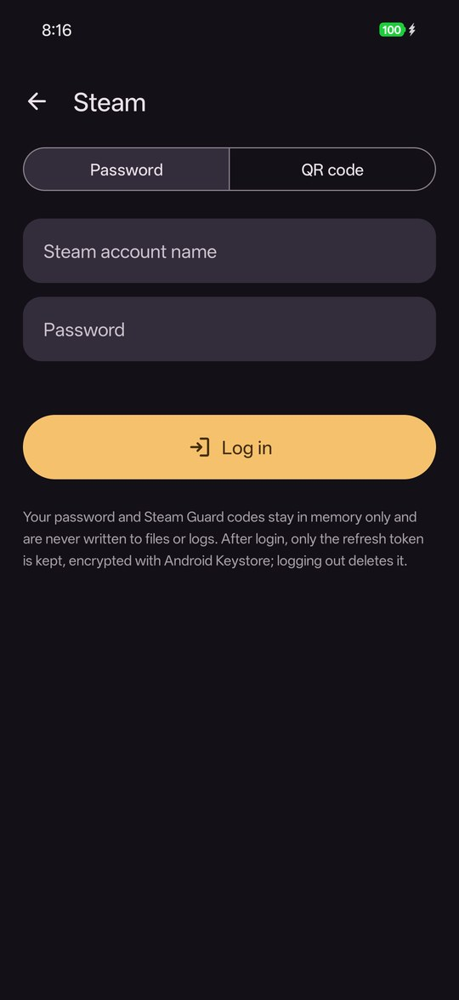
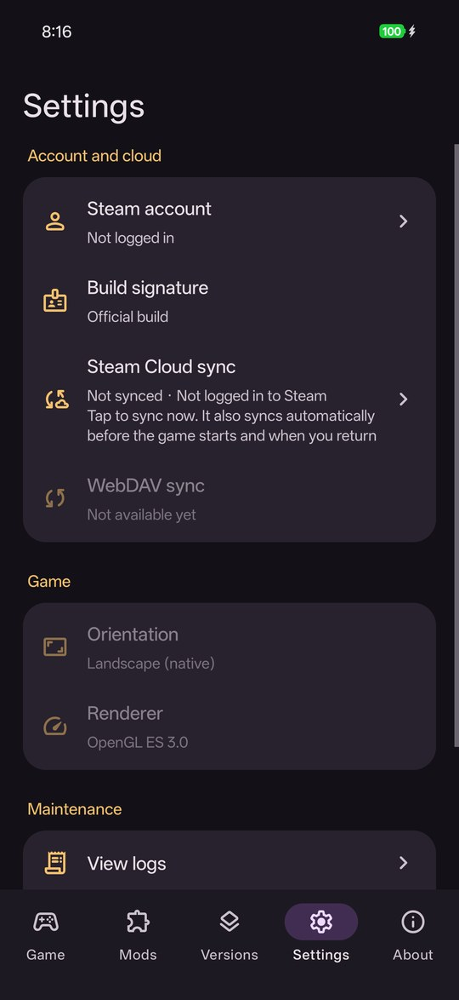
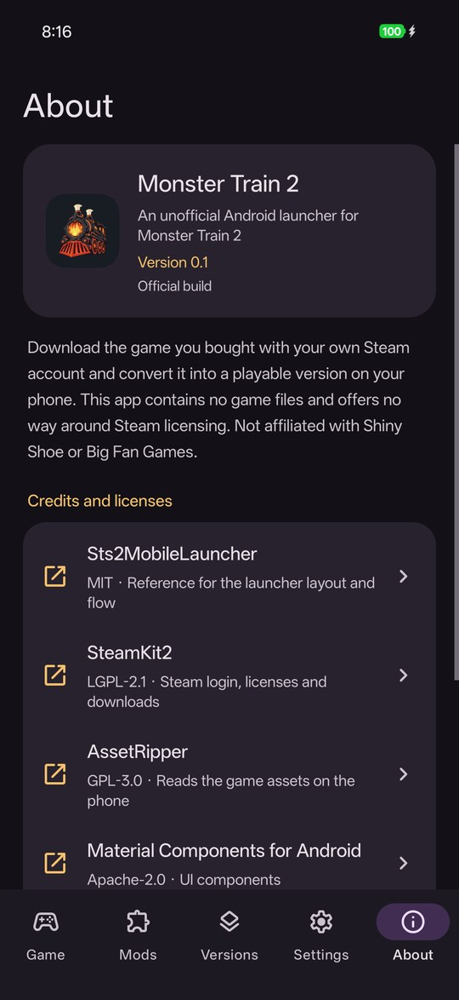

<div align="right">
  <strong>English</strong> · <a href="README_zh-TW.md">正體中文</a> · <a href="README_zh-CN.md">简体中文</a>
</div>

<p align="center">
  
</p>

<h1 align="center">Monster Train 2 Android Launcher</h1>

<p align="center">
  An unofficial, open-source Android launcher for <i>Monster Train 2</i>. It downloads the game you own with your Steam account, converts it on your phone, and syncs your saves with Steam Cloud.
</p>

<p align="center">
  <a href="LICENSE"></a>
  
  
  
</p>

> **Status:** early development. The latest officially signed build is [v0.2](https://github.com/jason5545/mt2-mobile-launcher/releases/tag/v0.2) (pre-release), for game version 2.3.0.

## Screenshots

<p align="center">
  
  
  
  
</p>

## About the Project

This project is an unofficial Android launcher for *Monster Train 2*. It **DOES NOT** contain any game files. You log in with your own Steam account, the launcher checks that the account owns the game, downloads the PC version from Steam, and converts it on the phone into a version that runs there. You can also import the PC game folder yourself.

The approach follows [Sts2MobileLauncher](https://github.com/ModinMobileSTS/Sts2MobileLauncher), which runs the PC version of *Slay the Spire 2* on Android. The difference is the engine. *Slay the Spire 2* uses Godot, whose PC files can run on Android directly. *Monster Train 2* uses Unity (Mono): the game logic DLLs run on .NET, but Unity's native engine (rendering, physics, audio, asset formats) has no Android build that can be used here. So the launcher ships a hand-written native half of UnityEngine (unity-native), patches the original DLLs on the phone to run on top of it, and converts the assets and shaders on the phone into formats it can read.

**Features:**
- Steam login with a QR code (scan with the Steam app) or with account name, password and Steam Guard.
- License check, then download of the pinned game version from Steam. DLC follows your Steam license: only DLC you own is enabled.
- Import the PC game folder instead of downloading. Imported installs keep DLC off until you log in to Steam.
- On-phone install pipeline, about 9 minutes. Every step can resume after the app is closed or the screen turns off.
- Two-way Steam Cloud sync before the game starts and when you return to the launcher. Conflicts ask you which side to keep, and saves that get overwritten are backed up first.
- Interface in English, Traditional Chinese and Simplified Chinese, following the phone's language (Android 13+ can set it per app).

**Layers:**
1. **Launcher shell** (`src/Launcher`, `src/Steam`): Steam login, license check, depot download, Steam Cloud sync, settings, and the install service. Built on .NET for Android with SteamKit2.
2. **Install pipeline** (`src/Patcher`, AssetRipper, `src/Importer`, `src/Shaders`): patches the original DLLs, extracts and converts assets and scenes, and converts DX11 shaders to GLSL. Runs inside the launcher on the phone.
3. **Engine and host** (`src/UnityNative`, `src/Glue.*`, `src/Launcher/GameHost`): the hand-written UnityEngine native half, the Android host, and the adapter assemblies the patched game calls into. Runs the game on CoreCLR.
4. **Base game (provided by you):** downloaded from Steam with an account that owns *Monster Train 2*, or imported from the PC version.

**Requirements:**
- Android 9.0 or later, arm64.
- About 15 GB of free space to download and install from Steam (the launcher checks before it starts); about 6 GB stays after the install.
- The install step can use up to about 4.7 GB of memory.
- Supported game versions: Windows builds 2.3.0 and 2.2.1 (Unity 2022.3.62f2); Steam download gets 2.3.0. The launcher compares the SHA-256 of the original DLLs before converting and only runs versions it supports. When Steam ships a newer version, wait for a launcher update.

---

## Legal Disclaimer

- **Unofficial project:** this launcher is not affiliated with, endorsed by, or licensed by Shiny Shoe, Big Fan Games, or Unity Technologies.
- **No game assets provided:** this repository and the released APKs **DO NOT** contain or distribute any game files (code, assets, shaders, text) or anything converted from them. Patched DLLs and converted assets are created only on your own device and stay there.
- **Legal use:** you must **own** *Monster Train 2* on Steam (PC). The launcher does not provide any way around Steam licensing. Please follow the Steam Subscriber Agreement and your local laws.
- **No APKs with game assets:** do not distribute APKs that bundle game files.

---

## Credits & References

- **[Sts2MobileLauncher](https://github.com/ModinMobileSTS/Sts2MobileLauncher)** (MIT): the launcher's layout, flow and animations are adapted from it, and the Material Symbols drawables are copied from it.
- **[SteamKit2](https://github.com/SteamRE/SteamKit)** (LGPL-2.1): Steam login, license check, depot download and Steam Cloud.
- **[AssetRipper](https://github.com/AssetRipper/AssetRipper)** (GPL-3.0): reads the game's assets on the phone. Built from upstream with the changes in `third_party/AssetRipper/assetripper-local.patch`.
- **[UnityPy](https://github.com/K0lb3/UnityPy)**, **[AssetsTools.NET](https://github.com/nesrak1/AssetsTools.NET)**, **[Mono.Cecil](https://github.com/jbevain/cecil)** (MIT): type trees, asset reading and DLL patching.
- **[dxbc-spirv](https://github.com/doitsujin/dxbc-spirv)** (MIT) and **[SPIRV-Cross](https://github.com/KhronosGroup/SPIRV-Cross)** (Apache-2.0): shader conversion.
- **[FreeType](https://freetype.org/)** (FTL): font glyphs.
- **[Material Components for Android](https://github.com/material-components/material-components-android)**, **[Material Symbols](https://github.com/google/material-design-icons)** (Apache-2.0) and **[QRCoder](https://github.com/Shane32/QRCoder)** (MIT): user interface and the login QR code.
- **[.NET](https://github.com/dotnet/runtime)** (MIT): the runtime the launcher and the game run on.

*(Full list, versions and license texts: [THIRD_PARTY_NOTICES.md](THIRD_PARTY_NOTICES.md). The APK includes AssetRipper under GPL-3.0, so each release ships the matching source code.)*

---

## Security Notes

1. **Steam account:**
   - Prefer logging in with the QR code, so you never type your password in this app. With password login, the password and Steam Guard code stay in memory only; they are never written to disk, logs or Android intents.
   - After login, only the refresh token is kept, encrypted with Android Keystore. Logging out deletes it.
   - Logs never contain tokens, passwords or full SteamIDs.
2. **Official builds:** the launcher compares its own APK signing certificate with the official fingerprint below. Official builds turn on Steam features directly. Any other build shows a risk warning first, because a modified APK can read your password, Steam Guard code and refresh token. This is a reminder, not a protection: a modified APK can remove the check. Only install APKs from this repository's [releases](https://github.com/jason5545/mt2-mobile-launcher/releases), and check the certificate yourself:
   ```bash
   apksigner verify --print-certs <APK>
   # certificate SHA-256 digest: ea3c5c9dd9c64a811497a42118d71d2e41557c78fae45bf0b9fb4a293548f2f8
   ```
3. **No `debuggable`:** release builds are not debuggable, so other apps or computers with ADB access cannot read this app's data through it.
4. **Network:** the launcher only talks to Steam (CM servers, CDN, Cloud). Steam Cloud transfers go to the storage hosts Steam returns (Google Cloud Storage and AWS S3 buckets named `steamcloud-*`). There is no launcher server and no other third-party service.

---

## How to Build

> Building needs your own copy of the Windows version of *Monster Train 2* for every version in `targets/` (now 2.2.1 and 2.3.0): the engine is compiled against the original DLLs, and the build checks their SHA-256. Without the game files you cannot build a complete APK.

### 1. Prerequisites
- macOS (Apple Silicon) or Linux.
- .NET 10 SDK with the `android` workload (`DOTNET_ROOT`, default `~/.dotnet-android/sdk`), Android SDK, and NDK 28 (`ANDROID_NDK_HOME`).
- git, CMake, Meson, Ninja, Python 3.
- The Windows game folders of *Monster Train 2* 2.2.1 and 2.3.0 (`MonsterTrain2_Data/Managed` is what the build reads), passed as `GAME_DIR=<2.2.1>:<2.3.0>`.

### 2. Get the source code
```bash
git clone https://github.com/jason5545/mt2-mobile-launcher.git
cd mt2-mobile-launcher
git config core.hooksPath .githooks   # pre-commit check that blocks game files and private data
```

### 3. Build the native libraries
FreeType, dxbc-spirv and SPIRV-Cross are fetched from upstream at build time and compiled for Android arm64:
```bash
native/freetype/build.sh android
native/dxbc-spirv/build.sh android
native/spirv-cross/build.sh android
```

### 4. Build the APK
```bash
GAME_DIR=/path/to/MT2-2.2.1:/path/to/MT2-2.3.0 tools/phase4/build.sh [output folder]
```
This fetches AssetRipper and applies the local patch, builds the patcher, the engine (`src/UnityNative`), the game adapters (`src/Glue.*`) and the launcher APK, and computes the patch results the phone must match. All output goes outside the repository (default `~/mt2-phase4/apk`). Without `RELEASE=1` the APK is signed with your machine's debug key and counts as an unofficial build.

### 5. Release packaging (maintainer)
```bash
RELEASE=1 GAME_DIR=… tools/phase4/build.sh <output>
GAME_DIR=… tools/release/package.sh <same output> <folder outside the repository>
```
`package.sh` checks that HEAD is the commit that was built, that the APK has the official signature, contains no game files or patched DLLs, and lists every component in THIRD_PARTY_NOTICES.md. It then writes the APK, its SHA-256, the source code of the launcher, AssetRipper and the native libraries, and the license files.

---

## More Documentation

- [Third-party notices](THIRD_PARTY_NOTICES.md)
- [Rules for contributors and AI agents](AGENTS.md)
