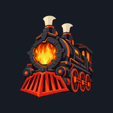
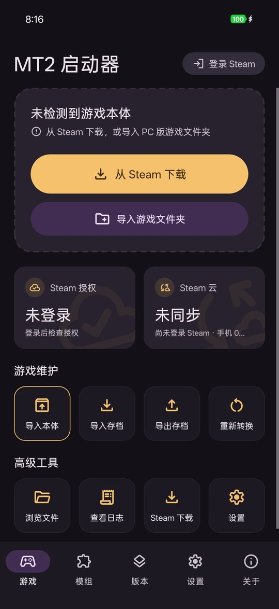
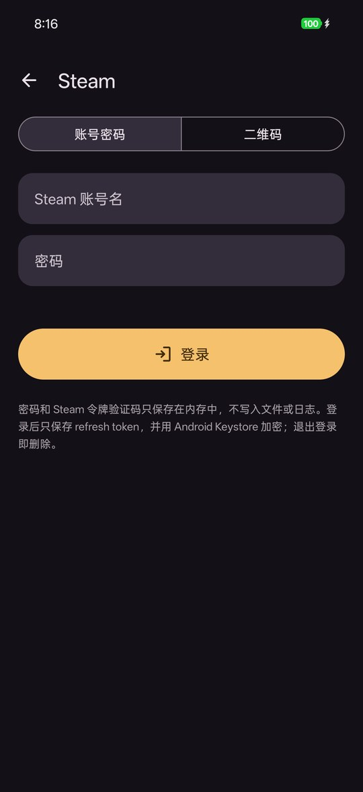
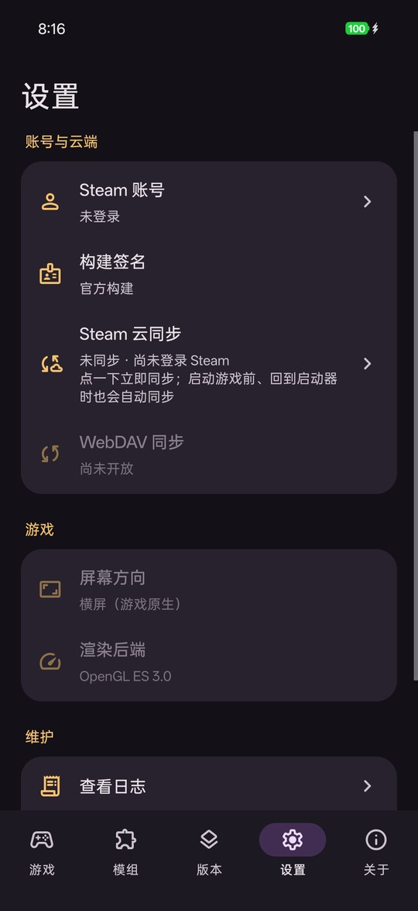
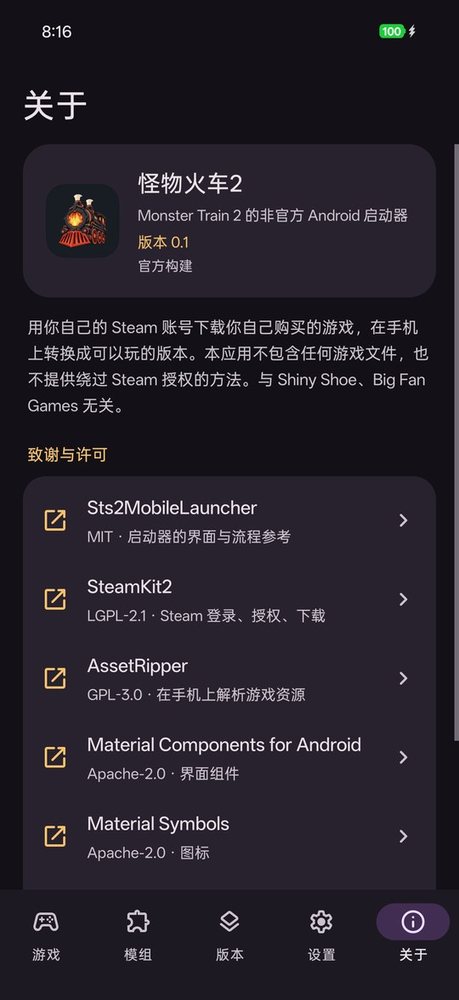

<div align="right">
  <a href="README.md">English</a> · <a href="README_zh-TW.md">正體中文</a> · <strong>简体中文</strong>
</div>

<p align="center">
  
</p>

<h1 align="center">怪物火车2 Android 启动器</h1>

<p align="center">
  <i>Monster Train 2</i> 的非官方开源 Android 启动器。用你自己的 Steam 账号下载你购买的游戏，在手机上转换，存档与 Steam 云同步。
</p>

<p align="center">
  <a href="LICENSE"></a>
  
  
  
</p>

> **状态：** 开发早期。最新的官方签名构建是 [v0.2](https://github.com/jason5545/mt2-mobile-launcher/releases/tag/v0.2)（pre-release），支持游戏 2.3.0。

## 截图

<p align="center">
  
  
  
  
</p>

## 关于本项目

这是 *Monster Train 2* 的非官方 Android 启动器，**不包含**任何游戏文件。你用自己的 Steam 账号登录，启动器确认该账号拥有游戏后，从 Steam 下载 PC 版，在手机上转换成可以在手机上运行的版本。也可以自行导入 PC 版的游戏文件夹。

做法参考 [Sts2MobileLauncher](https://github.com/ModinMobileSTS/Sts2MobileLauncher)，它让《杀戮尖塔2》的 PC 版在 Android 上运行。区别在于引擎：《杀戮尖塔2》使用 Godot，PC 版文件可以直接在 Android 上运行；*Monster Train 2* 使用 Unity（Mono），游戏逻辑的 DLL 可以在 .NET 上运行，但 Unity 的原生引擎（渲染、物理、音频、资源格式）没有能在这里使用的 Android 版本。因此启动器自带一份手写的 UnityEngine 原生部分（unity-native），在手机上把原版 DLL 修补后接到这套引擎上运行，资源与着色器也在手机上转换成它能读取的格式。

**功能：**
- Steam 登录：用 Steam App 扫描二维码，或账号密码加 Steam 令牌。
- 确认授权后，从 Steam 下载固定的游戏版本。DLC 按 Steam 授权开启，买了哪个才开哪个。
- 也可以导入 PC 版游戏文件夹。导入的版本 DLC 先关闭，登录 Steam 后按授权开启。
- 在手机上安装转换，大约 9 分钟。关闭应用或熄屏后，每一步都能接着继续。
- 启动游戏前、回到启动器时，与 Steam 云双向同步。有冲突时让你选择保留哪一边，被覆盖的存档会先备份。
- 界面支持英文、繁体中文、简体中文，跟随手机语言（Android 13 起可以单独为本应用设置）。

**分层：**
1. **启动器外壳**（`src/Launcher`、`src/Steam`）：Steam 登录、授权检查、下载 depot、Steam 云同步、设置、安装服务。基于 .NET for Android 和 SteamKit2。
2. **安装流程**（`src/Patcher`、AssetRipper、`src/Importer`、`src/Shaders`）：修补原版 DLL、解包并转换资源与场景、把 DX11 着色器转换成 GLSL。在手机上、启动器内部运行。
3. **引擎与宿主**（`src/UnityNative`、`src/Glue.*`、`src/Launcher/GameHost`）：手写的 UnityEngine 原生部分、Android 宿主，以及修补后的游戏会调用的适配程序集。在 CoreCLR 上运行游戏。
4. **游戏本体（由你提供）：** 用拥有 *Monster Train 2* 的账号从 Steam 下载，或从 PC 版导入。

**需要：**
- Android 9.0 及以上，arm64。
- 从 Steam 下载并安装，大约需要 15 GB 可用空间（开始前启动器会检查）；安装完成后保留约 6 GB。
- 安装步骤最多会使用约 4.7 GB 内存。
- 支持的游戏版本：Windows 版 2.3.0 与 2.2.1（Unity 2022.3.62f2），Steam 下载获取 2.3.0。转换前启动器会比对原版 DLL 的 SHA-256，只运行支持的版本。Steam 推出新版本时，需要等待启动器更新。

---

## 法律声明

- **非官方项目：** 本启动器与 Shiny Shoe、Big Fan Games、Unity Technologies 没有隶属、背书或授权关系。
- **不提供游戏资源：** 本仓库和发布的 APK **不包含**、也不分发任何游戏文件（代码、资源、着色器、文本），也没有从它们转换出来的内容。修补后的 DLL 和转换后的资源只在你自己的设备上生成，也只保存在那里。
- **合法使用：** 你必须在 Steam（PC）上**拥有** *Monster Train 2*。启动器不提供绕过 Steam 授权的方法。请遵守 Steam 订户协议和当地法律。
- **禁止分发捆绑游戏资源的 APK。**

---

## 致谢与参考

- **[Sts2MobileLauncher](https://github.com/ModinMobileSTS/Sts2MobileLauncher)**（MIT）：启动器的界面布局、流程与动画改写自它，Material Symbols 图标文件也取自它。
- **[SteamKit2](https://github.com/SteamRE/SteamKit)**（LGPL-2.1）：Steam 登录、授权检查、depot 下载与 Steam 云。
- **[AssetRipper](https://github.com/AssetRipper/AssetRipper)**（GPL-3.0）：在手机上读取游戏资源。从上游构建，并加上 `third_party/AssetRipper/assetripper-local.patch` 的修改。
- **[UnityPy](https://github.com/K0lb3/UnityPy)**、**[AssetsTools.NET](https://github.com/nesrak1/AssetsTools.NET)**、**[Mono.Cecil](https://github.com/jbevain/cecil)**（MIT）：typetree、资源读取、DLL 修补。
- **[dxbc-spirv](https://github.com/doitsujin/dxbc-spirv)**（MIT）与 **[SPIRV-Cross](https://github.com/KhronosGroup/SPIRV-Cross)**（Apache-2.0）：着色器转换。
- **[FreeType](https://freetype.org/)**（FTL）：字形。
- **[Material Components for Android](https://github.com/material-components/material-components-android)**、**[Material Symbols](https://github.com/google/material-design-icons)**（Apache-2.0）与 **[QRCoder](https://github.com/Shane32/QRCoder)**（MIT）：界面与登录二维码。
- **[.NET](https://github.com/dotnet/runtime)**（MIT）：启动器和游戏的运行环境。

*（完整列表、版本与许可证原文见 [THIRD_PARTY_NOTICES.md](THIRD_PARTY_NOTICES.md)。APK 包含 GPL-3.0 的 AssetRipper，所以每个 release 都附带对应的源代码。）*

---

## 安全须知

1. **Steam 账号：**
   - 建议用二维码登录，这样无需在本应用中输入密码。使用账号密码登录时，密码和 Steam 令牌验证码只保存在内存中，不写入磁盘、日志或 Android Intent。
   - 登录后只保存 refresh token，并用 Android Keystore 加密；退出登录即删除。
   - 日志不记录 token、密码和完整的 SteamID。
2. **官方构建：** 启动器会将自身 APK 的签名证书与下面的官方指纹比对。官方构建直接开放 Steam 功能；其他构建会先弹出风险提示，因为修改过的 APK 可以读取你的密码、Steam 令牌验证码和 refresh token。这只是提醒，不是防护：修改过的 APK 可以去掉这项检查。请只从本仓库的 [releases](https://github.com/jason5545/mt2-mobile-launcher/releases) 安装，也可以自行核对证书：
   ```bash
   apksigner verify --print-certs <APK>
   # certificate SHA-256 digest: ea3c5c9dd9c64a811497a42118d71d2e41557c78fae45bf0b9fb4a293548f2f8
   ```
3. **不开启 `debuggable`：** release 版本不是 debuggable，拥有 ADB 权限的电脑或应用无法借此读取本应用的数据。
4. **网络：** 启动器只连接 Steam（CM 服务器、CDN、云）。Steam 云的传输使用 Steam 指定的存储主机（Google Cloud Storage 和 AWS S3 上名为 `steamcloud-*` 的存储空间）。启动器没有自建服务器，也不接入其他第三方服务。

---

## 如何构建

> 构建需要你自己的 Windows 版 *Monster Train 2*，`targets/` 里的每个版本都需要一份（现在是 2.2.1 与 2.3.0）：引擎是针对原版 DLL 编译的，构建时会比对它们的 SHA-256。没有游戏文件就无法构建完整的 APK。

### 1. 环境要求
- macOS（Apple Silicon）或 Linux。
- .NET 10 SDK 及 `android` workload（`DOTNET_ROOT`，默认 `~/.dotnet-android/sdk`）、Android SDK、NDK 28（`ANDROID_NDK_HOME`）。
- git、CMake、Meson、Ninja、Python 3。
- *Monster Train 2* 2.2.1 与 2.3.0 的 Windows 版游戏文件夹（构建读取的是 `MonsterTrain2_Data/Managed`），用 `GAME_DIR=<2.2.1>:<2.3.0>` 传给构建脚本。

### 2. 获取源代码
```bash
git clone https://github.com/jason5545/mt2-mobile-launcher.git
cd mt2-mobile-launcher
git config core.hooksPath .githooks   # 提交前检查，拦截游戏文件和私人数据
```

### 3. 构建原生库
FreeType、dxbc-spirv、SPIRV-Cross 在构建时从上游获取，编译成 Android arm64：
```bash
native/freetype/build.sh android
native/dxbc-spirv/build.sh android
native/spirv-cross/build.sh android
```

### 4. 构建 APK
```bash
GAME_DIR=/path/to/MT2-2.2.1:/path/to/MT2-2.3.0 tools/phase4/build.sh [输出文件夹]
```
它会获取 AssetRipper 并应用本地补丁，依次编译 patcher、引擎（`src/UnityNative`）、适配程序集（`src/Glue.*`）和启动器 APK，再算出手机上修补结果需要对上的期望值。所有输出都放在仓库外（默认 `~/mt2-phase4/apk`）。不带 `RELEASE=1` 时使用本机的 debug 密钥签名，属于非官方构建。

### 5. 发布打包（维护者）
```bash
RELEASE=1 GAME_DIR=… tools/phase4/build.sh <输出>
GAME_DIR=… tools/release/package.sh <同一个输出> <仓库外的文件夹>
```
`package.sh` 先确认 HEAD 就是构建时的 commit、APK 是官方签名、里面没有游戏文件或修补过的 DLL、每个组件都列在 THIRD_PARTY_NOTICES.md 中，然后产出 APK、SHA-256、启动器与 AssetRipper 及原生库的源代码，以及许可证文件。

---

## 更多文档

- [第三方许可](THIRD_PARTY_NOTICES.md)
- [参与者与 AI 代理规则](AGENTS.md)
