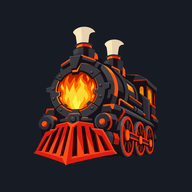
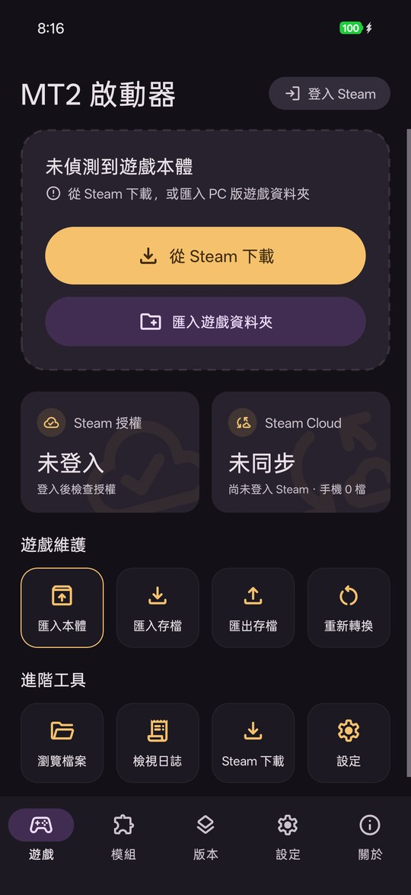
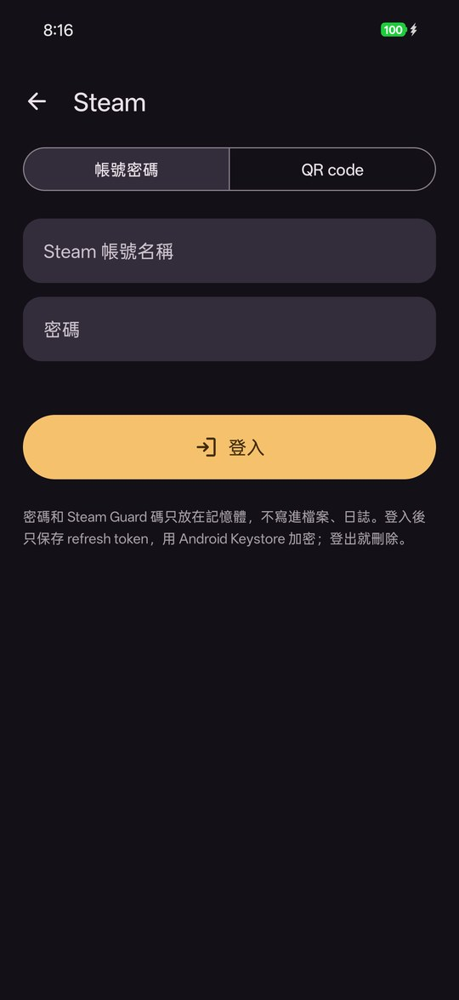
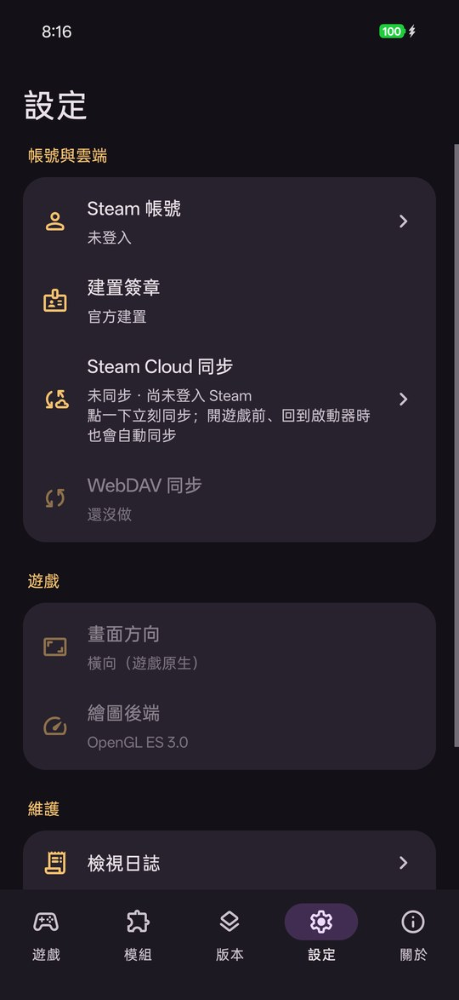
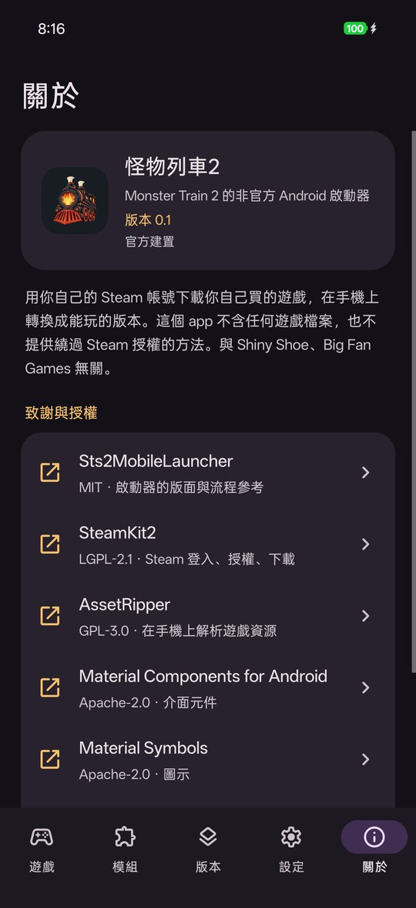

<div align="right">
  <a href="README.md">English</a> · <strong>正體中文</strong> · <a href="README_zh-CN.md">简体中文</a>
</div>

<p align="center">
  
</p>

<h1 align="center">怪物列車2 Android 啟動器</h1>

<p align="center">
  <i>Monster Train 2</i> 的非官方開源 Android 啟動器。用你自己的 Steam 帳號下載你買的遊戲，在手機上轉換，存檔跟 Steam Cloud 同步。
</p>

<p align="center">
  <a href="LICENSE"></a>
  
  
  
</p>

> **狀態：** 開發初期。最新的官方簽章建置是 [v0.2](https://github.com/jason5545/mt2-mobile-launcher/releases/tag/v0.2)（pre-release），支援遊戲 2.3.0。

## 截圖

<p align="center">
  
  
  
  
</p>

## 關於這個專案

這是 *Monster Train 2* 的非官方 Android 啟動器，**不含**任何遊戲檔案。你用自己的 Steam 帳號登入，啟動器確認這個帳號擁有遊戲，從 Steam 下載 PC 版，在手機上轉換成能在手機跑的版本。也可以自己匯入 PC 版的遊戲資料夾。

做法參考 [Sts2MobileLauncher](https://github.com/ModinMobileSTS/Sts2MobileLauncher)，它讓《殺戮尖塔2》的 PC 版在 Android 上跑。差別在引擎：《殺戮尖塔2》用 Godot，PC 版的檔案可以直接在 Android 上跑；*Monster Train 2* 用 Unity（Mono），遊戲邏輯的 DLL 能在 .NET 上跑，但 Unity 的原生引擎（繪製、物理、聲音、素材格式）沒有能用在這裡的 Android 版。所以啟動器帶一份手寫的 UnityEngine 原生半邊（unity-native），在手機上把原版 DLL patch 成接到這份引擎上執行，素材與 shader 也在手機上轉成它讀得懂的格式。

**功能：**
- Steam 登入：用 Steam App 掃 QR code，或帳號密碼加 Steam Guard。
- 確認授權後，從 Steam 下載固定的遊戲版本。DLC 照 Steam 的授權開，買了哪個才開哪個。
- 也可以匯入 PC 版的遊戲資料夾。匯入的版本 DLC 先關著，登入 Steam 後照授權開。
- 在手機上安裝轉換，約 9 分鐘。關掉 app 或螢幕關掉後，每一步都能接著做。
- 開遊戲前、回到啟動器時，跟 Steam Cloud 雙向同步。有衝突時讓你選要留哪一邊，被覆蓋的存檔先備份。
- 介面有英文、正體中文、簡體中文，跟著手機語系（Android 13 起可以單獨幫這個 app 選）。

**分層：**
1. **啟動器殼**（`src/Launcher`、`src/Steam`）：Steam 登入、授權檢查、下載 depot、Steam Cloud 同步、設定、安裝服務。.NET for Android 加 SteamKit2。
2. **安裝管線**（`src/Patcher`、AssetRipper、`src/Importer`、`src/Shaders`）：patch 原版 DLL、解開並轉換素材與場景、把 DX11 shader 轉成 GLSL。在手機上、啟動器裡面跑。
3. **引擎與宿主**（`src/UnityNative`、`src/Glue.*`、`src/Launcher/GameHost`）：手寫的 UnityEngine 原生半邊、Android 宿主，以及 patch 過的遊戲會呼叫的轉接組件。在 CoreCLR 上跑遊戲。
4. **遊戲本體（你自己的）：** 用擁有 *Monster Train 2* 的帳號從 Steam 下載，或從 PC 版匯入。

**需要：**
- Android 9.0 以上，arm64。
- 從 Steam 下載並安裝，約需 15 GB 可用空間（開始前啟動器會檢查）；裝完留下約 6 GB。
- 安裝那一步最多會用到約 4.7 GB 記憶體。
- 支援的遊戲版本：Windows 版 2.3.0 與 2.2.1（Unity 2022.3.62f2），Steam 下載抓 2.3.0。轉換前啟動器會比對原版 DLL 的 SHA-256，只跑支援的版本。Steam 推出新版時，要等啟動器更新。

---

## 法律聲明

- **非官方專案：** 這個啟動器與 Shiny Shoe、Big Fan Games、Unity Technologies 沒有隸屬、背書或授權關係。
- **不提供遊戲素材：** 這個 repo 和發布的 APK **不含**、也不散布任何遊戲檔案（程式、素材、shader、文字），也沒有從它們轉換出來的東西。patch 過的 DLL 與轉換後的素材只在你自己的裝置上產生，也只留在那裡。
- **合法使用：** 你必須在 Steam（PC）上**擁有** *Monster Train 2*。啟動器不提供繞過 Steam 授權的方法。請遵守 Steam 訂戶協議與當地法律。
- **不得散布夾帶遊戲素材的 APK。**

---

## 致謝與參考

- **[Sts2MobileLauncher](https://github.com/ModinMobileSTS/Sts2MobileLauncher)**（MIT）：啟動器的版面、流程與動畫改寫自它，Material Symbols 的圖示檔也取自它。
- **[SteamKit2](https://github.com/SteamRE/SteamKit)**（LGPL-2.1）：Steam 登入、授權檢查、depot 下載與 Steam Cloud。
- **[AssetRipper](https://github.com/AssetRipper/AssetRipper)**（GPL-3.0）：在手機上讀遊戲素材。從上游編，加上 `third_party/AssetRipper/assetripper-local.patch` 的修改。
- **[UnityPy](https://github.com/K0lb3/UnityPy)**、**[AssetsTools.NET](https://github.com/nesrak1/AssetsTools.NET)**、**[Mono.Cecil](https://github.com/jbevain/cecil)**（MIT）：typetree、素材讀取、DLL patch。
- **[dxbc-spirv](https://github.com/doitsujin/dxbc-spirv)**（MIT）與 **[SPIRV-Cross](https://github.com/KhronosGroup/SPIRV-Cross)**（Apache-2.0）：shader 轉換。
- **[FreeType](https://freetype.org/)**（FTL）：字形。
- **[Material Components for Android](https://github.com/material-components/material-components-android)**、**[Material Symbols](https://github.com/google/material-design-icons)**（Apache-2.0）與 **[QRCoder](https://github.com/Shane32/QRCoder)**（MIT）：介面與登入用的 QR code。
- **[.NET](https://github.com/dotnet/runtime)**（MIT）：啟動器和遊戲的執行環境。

*（完整清單、版本與授權原文見 [THIRD_PARTY_NOTICES.md](THIRD_PARTY_NOTICES.md)。APK 帶 GPL-3.0 的 AssetRipper，所以每個 release 都附上對應的原始碼。）*

---

## 安全須知

1. **Steam 帳號：**
   - 建議用 QR code 登入，就不用在這個 app 裡輸入密碼。用帳號密碼登入時，密碼和 Steam Guard 碼只放在記憶體，不寫進磁碟、log 或 Android 的 Intent。
   - 登入後只保存 refresh token，用 Android Keystore 加密；登出就刪除。
   - log 不寫 token、密碼、完整的 SteamID。
2. **官方建置：** 啟動器會拿自己 APK 的簽章憑證跟下面的官方指紋比。官方建置直接開放 Steam 功能；其他建置會先跳風險提示，因為改過的 APK 可以讀到你的密碼、Steam Guard 碼和 refresh token。這是提醒，不是防護：改過的 APK 可以把這個檢查拿掉。請只從這個 repo 的 [releases](https://github.com/jason5545/mt2-mobile-launcher/releases) 安裝，也可以自己核對憑證：
   ```bash
   apksigner verify --print-certs <APK>
   # certificate SHA-256 digest: ea3c5c9dd9c64a811497a42118d71d2e41557c78fae45bf0b9fb4a293548f2f8
   ```
3. **不開 `debuggable`：** release 版不是 debuggable，有 ADB 權限的電腦或 app 不能藉此讀這個 app 的資料。
4. **網路：** 啟動器只連 Steam（CM 伺服器、CDN、Cloud）。Steam Cloud 的傳輸走 Steam 指定的儲存主機（Google Cloud Storage 與 AWS S3 上名為 `steamcloud-*` 的空間）。啟動器沒有自架伺服器，也不串接其他第三方服務。

---

## 怎麼建置

> 建置要有你自己的 Windows 版 *Monster Train 2*，`targets/` 裡的每個版本都要一份（現在是 2.2.1 與 2.3.0）：引擎是對著原版 DLL 編的，建置時會比對它們的 SHA-256。沒有遊戲檔就編不出完整的 APK。

### 1. 需要的環境
- macOS（Apple Silicon）或 Linux。
- .NET 10 SDK 加 `android` workload（`DOTNET_ROOT`，預設 `~/.dotnet-android/sdk`）、Android SDK、NDK 28（`ANDROID_NDK_HOME`）。
- git、CMake、Meson、Ninja、Python 3。
- *Monster Train 2* 2.2.1 與 2.3.0 的 Windows 版遊戲資料夾（建置讀的是 `MonsterTrain2_Data/Managed`），用 `GAME_DIR=<2.2.1>:<2.3.0>` 傳給建置腳本。

### 2. 取得原始碼
```bash
git clone https://github.com/jason5545/mt2-mobile-launcher.git
cd mt2-mobile-launcher
git config core.hooksPath .githooks   # commit 前檢查，擋遊戲檔與私人資料
```

### 3. 編原生函式庫
FreeType、dxbc-spirv、SPIRV-Cross 在建置時從上游抓，編成 Android arm64：
```bash
native/freetype/build.sh android
native/dxbc-spirv/build.sh android
native/spirv-cross/build.sh android
```

### 4. 編 APK
```bash
GAME_DIR=/path/to/MT2-2.2.1:/path/to/MT2-2.3.0 tools/phase4/build.sh [輸出資料夾]
```
它會抓 AssetRipper 並套上本機的 patch，依序編 patcher、引擎（`src/UnityNative`）、轉接組件（`src/Glue.*`）與啟動器 APK，再算出手機上 patch 結果要對得上的期望值。所有輸出都放在 repo 外（預設 `~/mt2-phase4/apk`）。不帶 `RELEASE=1` 時用這台機器的 debug 金鑰簽，算非官方建置。

### 5. 發布打包（維護者）
```bash
RELEASE=1 GAME_DIR=… tools/phase4/build.sh <輸出>
GAME_DIR=… tools/release/package.sh <同一個輸出> <repo 外的資料夾>
```
`package.sh` 先確認 HEAD 就是建置的那個 commit、APK 是官方簽章、裡面沒有遊戲檔或 patch 過的 DLL、每個組件都列在 THIRD_PARTY_NOTICES.md，再產出 APK、SHA-256、啟動器與 AssetRipper 和原生函式庫的原始碼，以及授權文件。

---

## 更多文件

- [第三方授權](THIRD_PARTY_NOTICES.md)
- [給參與者與 AI 代理的規則](AGENTS.md)
